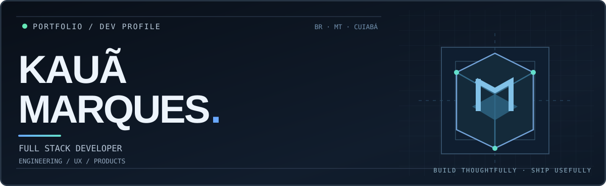
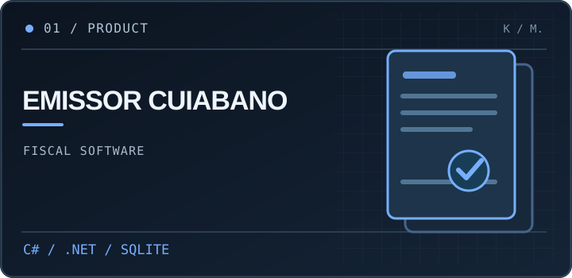
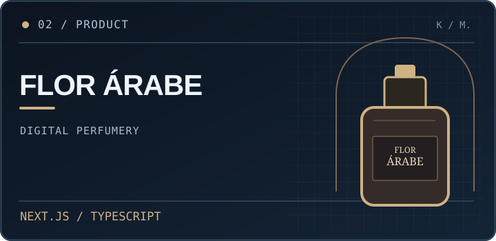
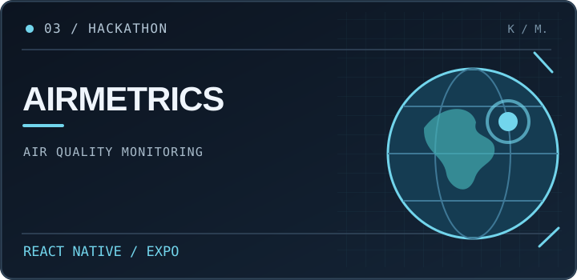
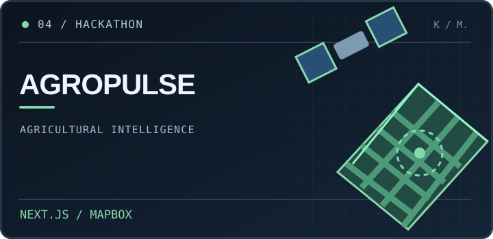
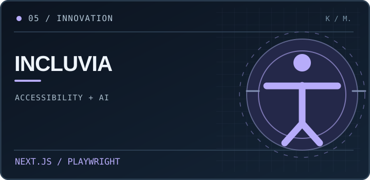
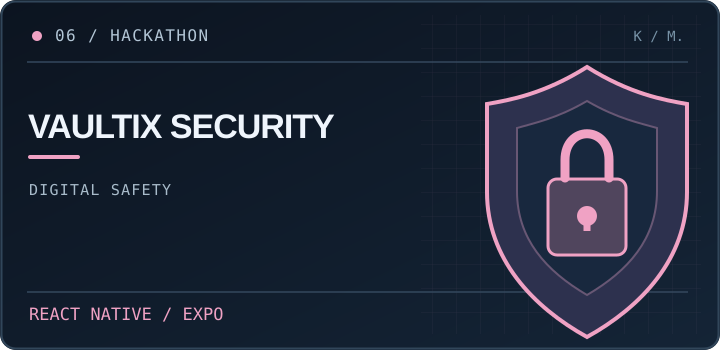

<a href="https://kauamarques.vercel.app"><strong>PORTFÓLIO ↗</strong></a>
&nbsp;&nbsp;·&nbsp;&nbsp;
<a href="https://www.linkedin.com/in/kauamqs"><strong>LINKEDIN ↗</strong></a>
&nbsp;&nbsp;·&nbsp;&nbsp;
<a href="https://github.com/KauaMarques-js?tab=repositories"><strong>REPOSITÓRIOS ↗</strong></a>

Software com propósito. Design com intenção. Código que resolve.

 

## 01 / Sobre

Sou **Kauã Marques Almeida**, desenvolvedor Full Stack de Cuiabá, MT. Curso **Engenharia de Software no UniSENAI** e tenho formação técnica em Análise e Desenvolvimento de Sistemas pelo SENAI.

Desenvolvo aplicações web e mobile, integrações e interfaces com foco em **produto, arquitetura simples e boa experiência de uso**. Minha experiência com suporte a sistemas fiscais na **Spedy** e TI em radiocomunicação na **SESP/MT** também influencia minha forma de construir software: primeiro entender o problema, depois resolver.

## 02 / Selected work

Projetos independentes e experiências em hackathons. Cada capa leva ao repositório público ou à demonstração disponível.

<table>
<tr>
<td width="50%" valign="top">
  
  <h3><a href="https://github.com/KauaMarques-js/Emissor-Cuiabano">Emissor Cuiabano</a></h3>
  
Sistema de gestão e emissão fiscal para empresas em Cuiabá/MT. Cadastro de empresas e serviços, NFS-e Nacional implementada e NF-e em simulação.

  
<code>C#</code> <code>.NET 10</code> <code>ASP.NET Core MVC</code> <code>SQLite</code>

  
<a href="https://github.com/KauaMarques-js/Emissor-Cuiabano"><strong>Explorar código e documentação →</strong></a>

</td>
<td width="50%" valign="top">
  
  <h3>Flor Árabe Perfumaria</h3>
  
Catálogo digital com identidade premium, experiência responsiva e seleção de perfumes com pedido direto pelo WhatsApp.

  
<code>Next.js</code> <code>React</code> <code>TypeScript</code> <code>Tailwind</code>

  
<a href="https://flor-arabe-perfumaria.vercel.app"><strong>Conhecer o site →</strong></a> · Código privado

</td>
</tr>
<tr>
<td width="50%" valign="top">
  
  <h3><a href="https://github.com/KauaMarques-js/AirMetrics">AirMetrics</a></h3>
  
Aplicativo de qualidade do ar com mapas, previsões e educação ambiental. Protótipo com dados simulados.

  
<code>React Native</code> <code>Expo</code> <code>TypeScript</code>

  
<strong>🥈 2º lugar · NASA Space Apps Cuiabá 2025</strong>

  
<a href="https://github.com/KauaMarques-js/AirMetrics"><strong>Explorar projeto →</strong></a>

</td>
<td width="50%" valign="top">
  
  <h3><a href="https://github.com/KauaMarques-js/AgroPulse">AgroPulse</a></h3>
  
Proposta de inteligência agrícola para transformar dados de observação da Terra em apoio à gestão de lavouras e riscos climáticos.

  
<code>Next.js</code> <code>TypeScript</code> <code>Mapbox</code>

  
<strong>CopernicusLAC Panama Hackathon 2026</strong>

  
<a href="https://github.com/KauaMarques-js/AgroPulse"><strong>Explorar projeto →</strong></a>

</td>
</tr>
<tr>
<td width="50%" valign="top">
  
  <h3>Incluvia</h3>
  
Auditoria de acessibilidade digital e análise de possíveis vieses contra pessoas com deficiência em sistemas de IA, com revisão humana dos achados.

  
<code>Next.js</code> <code>Prisma</code> <code>SQLite</code> <code>axe-core</code>

  
<strong>Sebrae Supernova 2026</strong>

  
<a href="https://youtu.be/mLNuLD4Fj-w?si=gq2XPhh7pxdNiW0S"><strong>▶ Assistir ao vídeo de apresentação →</strong></a> · Código privado

</td>
<td width="50%" valign="top">
  
  <h3><a href="https://github.com/KauaMarques-js/Vaultix-Security">Vaultix Security</a></h3>
  
MVP mobile de educação e prevenção de riscos digitais para crianças, adolescentes e responsáveis, com foco em privacidade e orientação segura.

  
<code>React Native</code> <code>Expo</code> <code>TypeScript</code>

  
<strong>Hacker Hero 2026</strong>

  
<a href="https://github.com/KauaMarques-js/Vaultix-Security"><strong>Explorar projeto →</strong></a>

</td>
</tr>
</table>

Projetos de hackathon são trabalhos de equipe. As descrições refletem o escopo documentado dos protótipos, não resultados de implantação em produção.

## 03 / Toolbox

**Frontend & mobile**  
`TypeScript` · `JavaScript` · `React` · `Next.js` · `React Native` · `Expo` · `Tailwind CSS`

**Backend & dados**  
`C#` · `.NET` · `ASP.NET Core` · `Node.js` · `Express` · `SQL` · `SQLite` · `Prisma`

**Engenharia & qualidade**  
`Git` · `GitHub` · `Playwright` · `axe-core` · `APIs REST` · `UI/UX`

## 04 / Mais trabalhos

- **[Meu portfólio](https://kauamarques.vercel.app)** — site pessoal com projetos, trajetória e contato. [Código-fonte](https://github.com/KauaMarques-js/Portfolio-Kaua-Marques).
- **[ADIA Framework](https://github.com/KauaMarques-js/landing-page-ADIA-FRAMEWORK)** — landing page de uma proposta educacional centrada em aprendizagem adaptativa.

---

SE VOCÊ TEM UMA IDEIA, EU GOSTO DE CONSTRUIR.

### Vamos criar algo que faça sentido?

<a href="https://kauamarques.vercel.app"><strong>Portfólio</strong></a>
&nbsp;&nbsp; / &nbsp;&nbsp;
<a href="https://www.linkedin.com/in/kauamqs"><strong>LinkedIn</strong></a>
&nbsp;&nbsp; / &nbsp;&nbsp;
<a href="https://github.com/KauaMarques-js"><strong>GitHub</strong></a>

  
© 2026 · Kauã Marques · Cuiabá, Brasil

