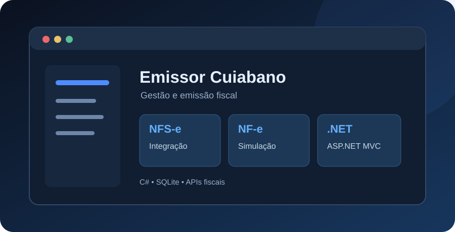
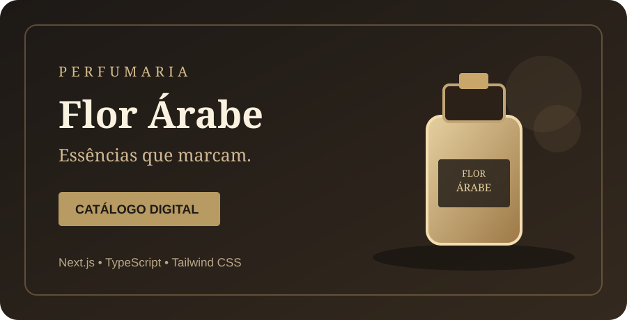
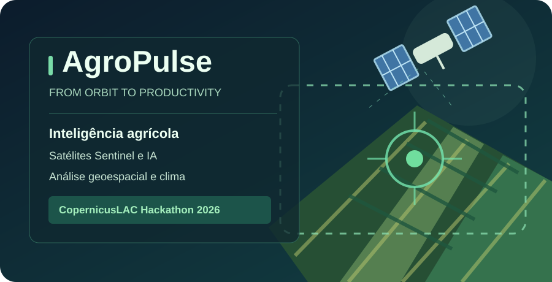
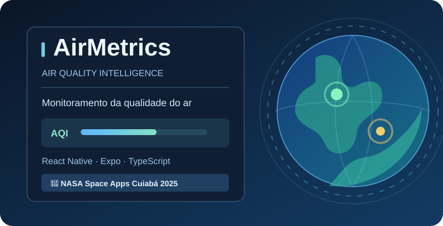
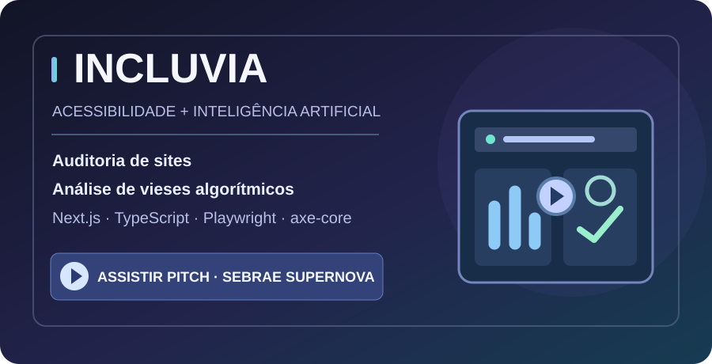
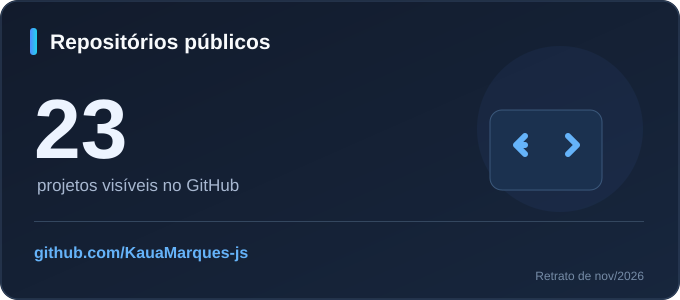
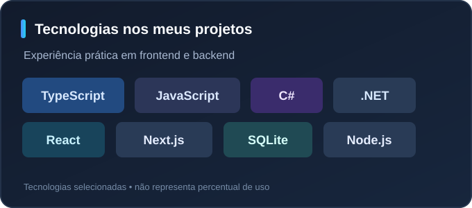

# Olá, eu sou Kauã Marques 👋

**Desenvolvedor Full Stack · Estudante de Engenharia de Software**

Crio aplicações web e APIs com foco em usabilidade, organização e problemas reais.

## Sobre mim

Sou de **Cuiabá (MT)**, curso **Engenharia de Software no UniSENAI** e tenho formação técnica em **Análise e Desenvolvimento de Sistemas** pelo SENAI.

Gosto de transformar necessidades reais em aplicações simples de usar e bem estruturadas. Minha experiência com suporte técnico e sistemas fiscais também me ajuda a pensar no produto pelo ponto de vista de quem vai utilizá-lo.

- 💻 **Interesses:** aplicações web, backend, integrações e experiência do usuário.
- 🛠️ **Experiência:** suporte a software fiscal (Spedy) e TI em radiocomunicação (SESP/MT).
- 🥈 **Conquista:** 2º lugar no NASA Space Apps Challenge Cuiabá 2025, com o projeto AirMetrics.
- 🌱 **Projetos de inovação e hackathons:** AgroPulse (CopernicusLAC Panama 2026), Vaultix Security (Hacker Hero 2026) e Incluvia (Sebrae Supernova 2026).

## Tecnologias

**Frontend & mobile**

**Backend & dados**

**Ferramentas**

## Projetos em destaque

<table>
<tr>
<td width="50%" valign="top">
  
  <h3>🧾 Emissor Cuiabano</h3>
  
Aplicação web para gestão e emissão de notas fiscais em Cuiabá/MT, com cadastro de empresas, clientes, produtos e serviços.

  
<strong>.NET 10 · ASP.NET Core MVC · C# · SQLite</strong>

  
Integração com a NFS-e Nacional; NF-e ainda em modo de simulação.

  
<em>Repositório privado · Projeto em desenvolvimento</em>

</td>
<td width="50%" valign="top">
  
  <h3>🌸 Flor Árabe Perfumaria</h3>
  
Catálogo digital de perfumes com identidade visual premium, navegação por produtos e pedidos encaminhados pelo WhatsApp.

  
<strong>Next.js · React · TypeScript · Tailwind CSS</strong>

  
<a href="https://flor-arabe-perfumaria.vercel.app"><strong>🌐 Ver site ao vivo</strong></a>

  
<em>Código privado · Site público</em>

</td>
</tr>
<tr>
<td valign="top" width="50%">
  
</td>
<td valign="top" width="50%">
  <h3>🌱 <a href="https://github.com/KauaMarques-js/AgroPulse">AgroPulse</a></h3>
  
Plataforma de apoio à decisão agrícola que propõe combinar observação da Terra, análise geoespacial e inteligência artificial para monitorar lavouras, riscos climáticos e prioridades de irrigação.

  
<strong>Next.js · React · TypeScript · Tailwind CSS · Mapbox</strong>

  
🛰️ <strong>3º CopernicusLAC Panama Hackathon 2026</strong> — Food Security Edition.

  
<a href="https://github.com/KauaMarques-js/AgroPulse"><strong>💻 Ver projeto e documentação no GitHub</strong></a>

</td>
</tr>
<tr>
<td width="50%" valign="top">
  
  <h3>🛰️ <a href="https://github.com/KauaMarques-js/AirMetrics">AirMetrics</a></h3>
  
Aplicativo mobile para monitoramento e educação sobre qualidade do ar, com mapas interativos, previsões, alertas e dados ambientais simulados.

  
<strong>React Native · Expo · TypeScript · React Native Maps</strong>

  
🥈 <strong>2º lugar no NASA Space Apps Challenge Cuiabá 2025</strong> — projeto desenvolvido em equipe.

  
<a href="https://github.com/KauaMarques-js/AirMetrics"><strong>💻 Ver aplicativo e documentação</strong></a>

</td>
<td width="50%" valign="top">
  
  <h3>🛡️ <a href="https://github.com/KauaMarques-js/Vaultix-Security">Vaultix Security</a></h3>
  
MVP mobile preventivo e educativo para ajudar crianças, adolescentes e responsáveis a reconhecer riscos digitais e encontrar canais seguros de orientação e apoio.

  
<strong>React Native · Expo · TypeScript</strong>

  
🔐 <strong>Hacker Hero 2026</strong> — foco em privacidade, proteção de dados, LGPD e ECA.

  
<a href="https://github.com/KauaMarques-js/Vaultix-Security"><strong>💻 Ver projeto e documentação</strong></a>

</td>
</tr>
<tr>
<td width="50%" valign="top">
  
  
<a href="https://youtu.be/mLNuLD4Fj-w?si=gq2XPhh7pxdNiW0S"><strong>▶️ Assistir ao vídeo de apresentação</strong></a>

</td>
<td width="50%" valign="top">
  <h3>♿ Incluvia</h3>
  
Plataforma para auditorias de acessibilidade digital e análise de possíveis vieses contra pessoas com deficiência em respostas de IA. Organiza achados, revisão humana e relatórios para apoiar a identificação de barreiras e do capacitismo algorítmico.

  
<strong>Next.js · TypeScript · Prisma · SQLite · Playwright · axe-core</strong>

  
🚀 <strong>Sebrae Supernova 2026</strong> — projeto de inovação e apresentação da ideia em vídeo.

  
<a href="https://youtu.be/mLNuLD4Fj-w?si=gq2XPhh7pxdNiW0S"><strong>🎥 Ver pitch no YouTube</strong></a>

  
<em>Repositório privado · Demonstração pública em vídeo</em>

</td>
</tr>
</table>

Ver uma captura da Flor Árabe

 

### Outros trabalhos

- **[Meu portfólio](https://github.com/KauaMarques-js/Portfolio-Kaua-Marques)** — site pessoal desenvolvido com Next.js e TypeScript. **[Visitar](https://kauamarques.vercel.app)**.
- **[ADIA Framework — landing page](https://github.com/KauaMarques-js/landing-page-ADIA-FRAMEWORK)** — apresentação de uma proposta educacional voltada à aprendizagem adaptativa com IA.

## Atividade no GitHub

  
  
  
Os cards acima ficam hospedados neste repositório. A quantidade é um retrato de novembro de 2026, não um contador em tempo real.

  
<a href="https://github.com/KauaMarques-js?tab=overview"><strong>Ver minhas contribuições e atividades diretamente no GitHub</strong></a>

---

**Vamos construir algo útil?**

[Portfólio](https://kauamarques.vercel.app) · [LinkedIn](https://www.linkedin.com/in/kauamqs)

